# 🔍 AI 생성 이미지 판별기 (Real vs AI-Generated Image Detector)

> 이미지 한 장을 올리면 **실제 사진인지, AI가 만든 이미지인지** 확률로 알려주는 웹 서비스입니다.
> 약 4만 8천 장의 이미지를 직접 수집·정제해 ResNet-50(베이스라인)과 CLIP ViT-L/14 + MLP(제안 모델)를 학습·비교했고,
> 배포 후 발견한 **인물 사진 오판 문제를 데이터 보강(v2)으로 개선**해 브라우저에서 동작하는 서비스로 배포했습니다.

---

## 0. 프로젝트 정보

| 항목 | 내용 |
|---|---|
| 학번 · 이름 | 202435134 · 이현재 |
| 데모 URL | https://ai-image-detector-delta-lac.vercel.app/ |
| GitHub URL | https://github.com/dyun6719-lab/ai-image-detector |
| 모델 가중치 (HF Hub) | https://huggingface.co/jun60287/ai-image-detector |
| 데이터 유형 / 학습 방식 | 이미지 이진 분류 / 전이학습 (ImageNet 사전학습 ResNet-50 파인튜닝, CLIP 사전학습 특징 + 분류 헤드) |
| 주요 지표 | F1 (보조: Accuracy, Precision, Recall, ROC-AUC) |

---

## 1. 문제 정의

### 4W
| | 내용 |
|---|---|
| **Who** | SNS·커뮤니티·뉴스에서 이미지를 접하는 일반 사용자, 팩트체크가 필요한 기자·학생 |
| **What** | 이미지가 **실제 카메라로 찍은 사진(real)** 인지 **생성형 AI가 만든 이미지(fake)** 인지 판별 |
| **When** | 출처가 불분명한 이미지를 공유·인용하기 전, 진위가 의심될 때 |
| **Why** | 생성 이미지가 사진과 구별하기 어려울 만큼 정교해져 허위정보 위험이 커졌고, 사람의 눈만으로는 판별이 어렵기 때문 |

### 기존 서비스 대비 차별점
1. **생성기 다양성:** Stable Diffusion 1.4 / 2.1 / XL, DeepFloyd IF, Midjourney, DALL-E, StyleGAN 등 여러 생성기 이미지를 섞어 학습
2. **처음 보는 생성기 평가:** 학습에 전혀 쓰지 않은 **GPT-4o 이미지**와 **직접 생성한 SDXL-Turbo 이미지(한국 일상 장면)** 로 일반화 성능을 별도 측정
3. **형식 지름길 차단:** real/fake 모두 동일한 해상도·JPEG 품질로 재압축해, 모델이 파일 형식이 아니라 이미지 내용을 학습하도록 설계
4. **개인정보 보호:** 모델이 **사용자 브라우저 안에서** 실행되어 이미지가 서버로 전송되지 않음

### 정량 목표
| 목표 | 결과 | 달성 |
|---|---|---|
| 테스트셋 F1 ≥ **0.90** | CLIP 0.951 (v1 test) / ResNet-50 v2 0.929 (v2 test) | ✅ |
| 처음 보는 생성기 F1 ≥ **0.80** | v1: CLIP 0.787 ❌ → **v2: ResNet-50 0.843** | ✅ (v2에서 달성) |

---

## 2. 데이터

### 출처 · 라이선스 · 규모
| 출처 | 라벨 | 용도 | 장수 | 라이선스 |
|---|---|---|---|---|
| [Kaggle – AI-Generated Images vs Real Images](https://www.kaggle.com/datasets/tristanzhang32/ai-generated-images-vs-real-images) (SD·Midjourney·DALL-E / Pexels·Unsplash·WikiArt) | fake / real | 학습 풀 | 15,000 / 15,000 | MIT |
| [ELSA D3](https://huggingface.co/datasets/elsaEU/ELSA_D3) – 생성기 4종 (SD 1.4, SD 2.1, SDXL, DeepFloyd IF 각 1,500) | fake | 학습 풀 | 6,000 | 데이터셋 카드에 별도 명시 없음 (같은 ELSA 프로젝트의 ELSA500k 등은 CC BY 4.0) · 비상업 교육 목적으로만 사용 |
| ELSA D3 – 같은 프롬프트의 실제 이미지 (LAION-400M URL) | real | 학습 풀 | 866 | 원 저작권은 각 이미지 소유자 · 비상업 교육 목적 |
| [GPT-4o 생성 이미지](https://huggingface.co/datasets/yufan/GPT4O_Image_T2I) | fake | **처음 보는 생성기 테스트** | 1,000 | 데이터셋 카드에 별도 명시 없음 · 비상업 교육 목적으로만 사용 |
| **직접 생성** – SDXL-Turbo, 한국 일상 장면 프롬프트 33종 × 촬영 스타일 10종 | fake | **처음 보는 생성기 테스트** | 1,500 | 본인 생성 (Stability AI 비상업 라이선스) |
| [140k Real and Fake Faces](https://www.kaggle.com/datasets/xhlulu/140k-real-and-fake-faces) – FFHQ 실제 얼굴 / StyleGAN 얼굴 *(v2에서 추가)* | real / fake | 학습 풀 + 얼굴 테스트 | 5,600 / 3,600 | FFHQ: CC BY-NC-SA 4.0 (NVIDIA) · 비상업 교육 목적 |
| **합계** | | | **48,566** | |

### 구성 (클래스 분포)
| 구분 | v1 fake : real | v2 fake : real |
|---|---|---|
| 학습 풀 | 21,000 : 15,866 (57 : 43) | 24,000 : 20,866 (**53 : 47**) |
| 처음 보는 생성기 (테스트 전용) | 2,500 : 0 | 2,500 : 0 |
| 얼굴 테스트 (테스트 전용, v2) | – | 600 : 600 |

- 약간의 불균형이 있어 정확도 대신 **F1·AUC** 를 주요 지표로 사용했습니다. v2에서 실제 얼굴 사진이 추가되며 비율이 더 균형에 가까워졌습니다.

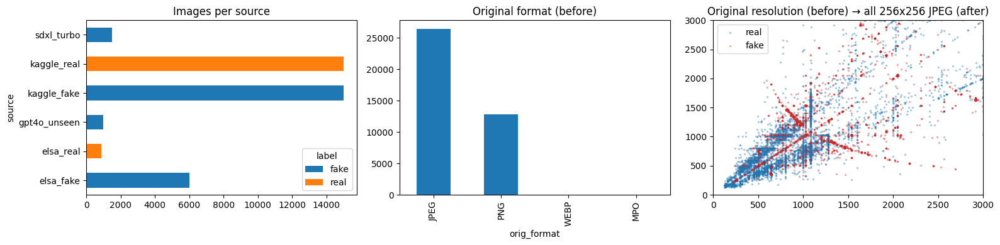

### 데이터 선정 이유
- **공개 데이터 하나로는 부족:** 대부분의 공개 데이터셋은 1~2개 생성기로만 만들어져, 다른 생성기 이미지에 약합니다. 출처가 다른 데이터를 섞어 **생성기 다양성**을 확보했습니다.
- **ELSA D3의 짝 데이터:** 같은 프롬프트에서 나온 real/fake 쌍이라, 피사체가 아니라 생성 흔적을 학습하는 데 유리합니다.
- **처음 보는 생성기 세트:** 실제 서비스에는 학습에 없던 생성기 이미지가 들어오므로, GPT-4o와 직접 만든 SDXL-Turbo 이미지로 일반화를 따로 검증합니다.
- **얼굴 데이터 (v2):** 배포 후 증명사진을 AI로 오판하는 문제를 발견해, 실제 얼굴과 AI 얼굴을 **함께** 추가했습니다. 실제 얼굴만 넣으면 반대로 "얼굴 = 진짜" 편향이 생기기 때문입니다.

---

## 3. 데이터 전처리

| # | 기법 | 목적 | 위치 |
|---|---|---|---|
| ① | **손상·저해상도 제거** (짧은 변 < 128px 제외) | 학습 불가능한 샘플 제거 | `01_collect_data.ipynb` |
| ② | **MD5 해시 중복 제거** | 같은 이미지가 train/test에 동시에 들어가는 누수 방지 | `01`, `03` |
| ③ | **256×256 정사각 리사이즈 + JPEG(품질 90) 재압축 통일** | real은 JPEG, fake는 PNG가 많아 생기는 **형식 지름길 학습 차단** | `01`, `03` |
| ④ | **데이터 증강** (RandomResizedCrop 224, 좌우반전, ColorJitter, GaussianBlur) | 과적합 방지 · 일반화 | `02`, `03` |
| ⑤ | **정규화** (ResNet: ImageNet 평균·표준편차 / CLIP: CLIP 평균·표준편차) | 사전학습 분포와 맞추기 | `02`, `03` |

### 전·후 비교
원본은 해상도(320×180 ~ 1536×1024)와 형식(PNG/JPEG)이 제각각이었지만, 전처리 후 모두 **256×256 JPEG90** 으로 통일했습니다.

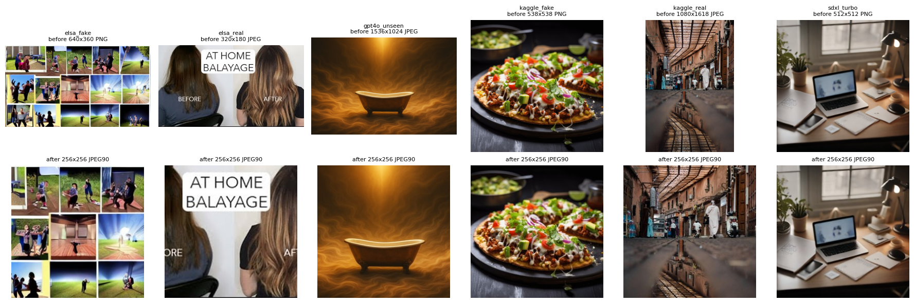
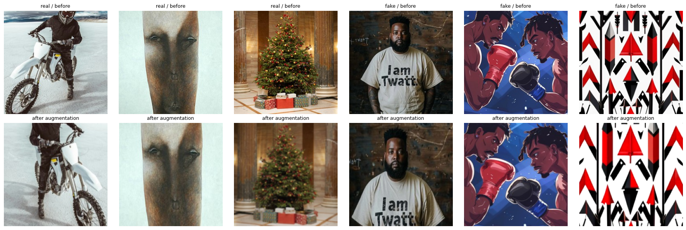

### 분할 (seed = 42)
학습 풀을 **라벨 × 출처 기준 층화 분할**로 train 70% / val 15% / test 15% 로 나누고, 처음 보는 생성기와 얼굴 테스트셋은 **학습에 쓰지 않는 테스트 전용**으로 분리했습니다.

| split | v1 (fake / real) | v2 (fake / real) |
|---|---|---|
| train | 14,700 / 11,106 = 25,806 | 16,800 / 14,606 = 31,406 |
| val | 3,150 / 2,380 = 5,530 | 3,600 / 3,130 = 6,730 |
| test | 3,150 / 2,380 = 5,530 | 3,600 / 3,130 = 6,730 |
| test_unseen | 2,500 / 0 | 2,500 / 0 |
| faces_test | – | 600 / 600 |

---

## 4. 모델

| | 베이스라인 | 제안 모델 | 개선 모델 (배포) |
|---|---|---|---|
| 이름 | **ResNet-50 v1** | **CLIP ViT-L/14 + MLP** | **ResNet-50 v2** |
| 구조 | ImageNet 사전학습 ResNet-50 + FC(2) | CLIP 이미지 인코더(고정) + MLP 헤드 (LayerNorm → Linear 768→512 → GELU → Dropout 0.3 → Linear 512→2) | v1과 동일 |
| 학습 방식 | 전이학습 – 전체 층 파인튜닝 | 특징 추출(좌우반전 2배 증강) → 헤드만 학습 | 전이학습 – 얼굴 데이터 추가 후 재학습 |
| 하이퍼파라미터 | 4 epoch, batch 64, AdamW(lr 1e-4, wd 1e-4), OneCycle, AMP | 30 epoch, batch 512, AdamW(lr 1e-3, wd 1e-2), Cosine, label smoothing 0.05 | v1과 동일 |
| 학습 파라미터 수 | 약 2,350만 | 헤드 약 40만 (인코더 약 3억은 고정) | 약 2,350만 |
| 체크포인트 선택 | val F1 최고 epoch | val F1 최고 epoch | val F1 최고 epoch |
| 학습 로그 | `results/log_resnet50.csv` | `results/log_clip_head.csv` | `results_v2/log_resnet50_v2.csv` |

### 모델 선정 이유
- **ResNet-50:** 가장 널리 쓰이는 CNN 기준 모델로, 픽셀 수준의 생성 흔적(텍스처·노이즈)을 직접 학습할 수 있어 베이스라인으로 적합합니다. 용량(90MB)이 작아 **브라우저 배포가 가능**하다는 장점도 있습니다.
- **CLIP ViT-L/14:** 대규모 이미지·텍스트 쌍으로 사전학습되어 특징이 매우 일반적입니다. 이 특징 공간에서 real/fake 경계를 학습하면 **학습에 없던 생성기에도 잘 일반화된다**는 연구 결과(Ojha et al., *Towards Universal Fake Image Detectors that Generalize Across Generative Models*, CVPR 2023)에 근거해 제안 모델로 선정했습니다.

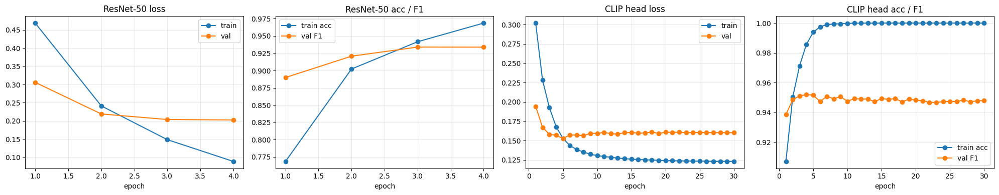

---

## 5. 평가 결과

### ① v1 비교: ResNet-50 vs CLIP (v1 데이터, 임계값 0.5, 양성 = fake)
| 모델 | 평가 세트 | Accuracy | Precision | Recall | F1 | ROC-AUC |
|---|---|---:|---:|---:|---:|---:|
| ResNet-50 v1 | test | 0.9105 | 0.9002 | 0.9479 | 0.9235 | 0.9725 |
| **CLIP ViT-L/14 + MLP** | test | **0.9436** | **0.9437** | **0.9581** | **0.9509** | **0.9844** |
| ResNet-50 v1 | 처음 보는 생성기 (+test real) | **0.8314** | 0.8585 | **0.8032** | **0.8299** | 0.9111 |
| CLIP ViT-L/14 + MLP | 처음 보는 생성기 (+test real) | 0.8068 | **0.9061** | 0.6948 | 0.7865 | **0.9220** |

> "처음 보는 생성기" 세트는 fake만 있으므로, 같은 수의 test real 이미지를 섞어 F1·AUC를 계산했습니다.

**분석:** CLIP은 학습 생성기 기준 test에서 5개 지표 모두 우세했습니다. 하지만 처음 보는 생성기에서는 **AUC는 더 높은데 F1은 더 낮았습니다**(Recall 0.695). 진짜/가짜의 **순서는 더 잘 매기지만**, 새 생성기 이미지의 P(fake)가 전반적으로 0.5보다 약간 낮게 나와 고정 임계값에서 놓치는 경우가 많았습니다. 학습 분포에 맞춰진 임계값이 새 분포에서는 너무 보수적인 **보정(calibration) 문제**로 해석했습니다. (테스트셋으로 임계값을 맞추면 데이터 누수이므로 하지 않았습니다.)

### ② 배포 후 발견한 문제 → v2 개선 (같은 v2 평가 세트에서 비교)
배포 후 직접 써보니 **보정된 증명사진을 AI로 오판**했습니다. 실제 얼굴 1,200장으로 테스트셋을 만들어 확인한 결과 문제가 구조적이었습니다.

| 모델 | 평가 세트 | Accuracy | Precision | Recall | F1 | ROC-AUC |
|---|---|---:|---:|---:|---:|---:|
| ResNet-50 v1 | **얼굴 테스트** | 0.4950 | 0.4974 | **0.9500** | 0.6529 | 0.5439 |
| **ResNet-50 v2** | **얼굴 테스트** | **0.9608** | **0.9710** | **0.9500** | **0.9604** | **0.9935** |
| ResNet-50 v1 | test (v2 분할) | 0.8434 | 0.7928 | **0.9575** | 0.8674 | 0.9203 |
| **ResNet-50 v2** | test (v2 분할) | **0.9223** | **0.9099** | 0.9486 | **0.9289** | **0.9782** |
| ResNet-50 v1 | 처음 보는 생성기 (+test real) | 0.7574 | 0.7358 | 0.8032 | 0.7680 | 0.8189 |
| **ResNet-50 v2** | 처음 보는 생성기 (+test real) | **0.8494** | **0.8783** | **0.8112** | **0.8434** | **0.9361** |

| | v1 | v2 |
|---|---:|---:|
| 실제 얼굴을 **진짜**로 맞힌 비율 | **4.0%** | **97.2%** |
| AI 얼굴을 **AI**로 맞힌 비율 | 95.0% | 95.0% |

**분석:**
- v1은 실제 얼굴의 **96%를 AI로 오판**했습니다(얼굴 테스트 AUC 0.544, 사실상 무작위). real 학습 데이터에 인물 사진이 거의 없어, 모델이 **"매끈한 얼굴 = AI"라는 지름길**을 학습한 것입니다.
- 실제 얼굴과 AI 얼굴을 함께 추가하자 **모든 세트에서 성능이 올랐고**, 특히 처음 보는 생성기 F1이 **0.843**으로 목표(0.80)를 달성해 v1의 CLIP(0.787)보다도 높아졌습니다. 다양한 실제 사진이 늘면서 "진짜 사진의 범위"를 더 넓게 배운 효과로 해석했습니다.
- AI 얼굴 탐지율은 95.0%로 **그대로 유지**되어, 실제 얼굴을 맞히는 능력만 크게 좋아졌습니다. 다만 얼굴 테스트의 AI 얼굴은 학습에 쓴 StyleGAN과 같은 생성기라, 최신 생성기의 AI 얼굴에서도 같은 성능이 나오는지는 추가 검증이 필요합니다.
- ⚠️ v1의 test·처음 보는 생성기 수치가 ① 표와 다른 것은 **평가 세트가 달라졌기 때문**입니다(v2 test에는 얼굴 사진이 포함되고, 처음 보는 생성기와 섞는 real 샘플도 달라짐). ② 표는 v1·v2를 **같은 세트**에서 비교한 것입니다.

### 최종 모델: **ResNet-50 v2** (서비스 배포)
| 기준 | 판단 |
|---|---|
| 정확도 | v2 test F1 0.929, 얼굴 F1 0.960, **처음 보는 생성기 F1 0.843 (모든 모델 중 최고)** |
| 일반화 | 새 생성기가 계속 나오는 실제 환경에서는 처음 보는 생성기 성능이 가장 중요 |
| 배포 가능성 | 90MB로 브라우저 실행 가능 (CLIP 인코더는 약 1.2GB라 무료 브라우저 배포가 어려움) |

> v1 test 기준으로는 CLIP(F1 0.951)이 가장 높았지만, 위 이유로 서비스에는 ResNet-50 v2를 배포했습니다.

### 결과 그래프 · 오류 사례
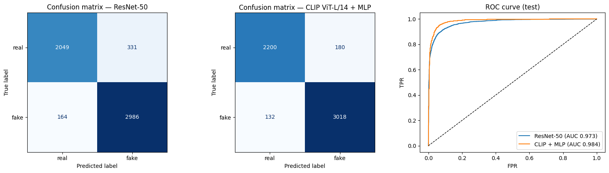
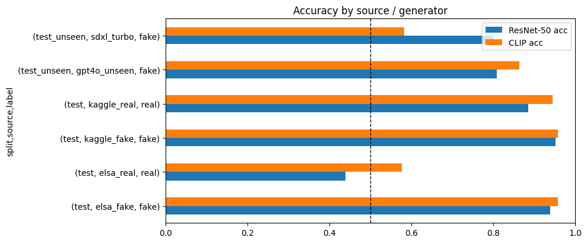
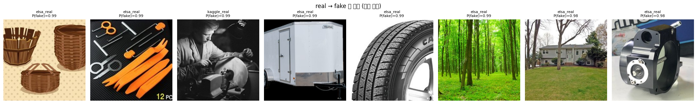
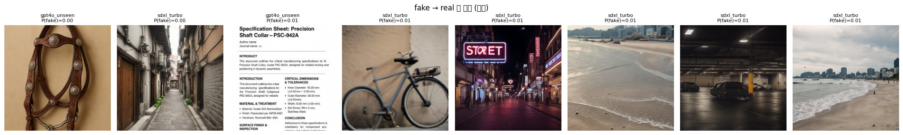

- **실사용 오류 사례:** 보정된 증명사진(매끈한 피부, 단색 배경, 고른 조명)을 v1이 AI로 오판 → v2에서 실제 사진으로 정상 판정
- **남은 약점:** 매우 사실적인 최신 생성기 이미지와 강하게 보정·압축된 사진은 여전히 헷갈릴 수 있습니다.

---

## 6. 서비스 프로토타입

### 모델 연동 방식
```
[사용자 브라우저]
  ① Vercel에서 웹페이지(index.html) 로드
  ② HF Hub에서 학습한 모델 resnet50.onnx(90MB) 다운로드 (최초 1회, 이후 브라우저 캐시)
  ③ 이미지 업로드 → 예외 처리 (이미지 파일이 아님 / 128px 미만이면 안내 메시지)
  ④ 학습과 동일한 전처리: 256 정사각 리사이즈 → JPEG90 재압축 → 224 가운데 크롭 → ImageNet 정규화
  ⑤ onnxruntime-web으로 브라우저 안에서 추론 → [P(real), P(fake)]
  ⑥ 판정 문구 + 확률 막대 표시 (확신도 35~65%면 경고)
```
- **본인이 학습한 모델 파일 사용:** 03 노트북에서 학습한 `resnet50_v2.pt`를 ONNX로 변환한 `resnet50.onnx`를 로드합니다. 변환 전후 출력 차이는 최대 약 9e-8 수준으로 검증했습니다.
- **서버 없이 브라우저에서 추론:** 이미지가 외부로 전송되지 않아 개인정보 측면에서 안전하고, 서버 비용이 들지 않습니다.
- 학습·서비스 전처리를 **완전히 동일하게** 맞춰 테스트 성능이 서비스에서도 재현되도록 했습니다.

### 사용 안내
1. 데모 URL 접속 → `✅ 모델 준비 완료` 표시 확인 (최초 접속 시 10~30초)
2. 이미지를 끌어다 놓거나 클릭해서 업로드 (JPG · PNG · WEBP, 가로·세로 128px 이상)
3. **판별하기** 클릭 → AI 생성 확률 확인 (50% 이상이면 AI 이미지로 판정)

### 화면 캡처
| 첫 화면 | 실제 사진 판별 | AI 이미지 판별 |
|---|---|---|
| 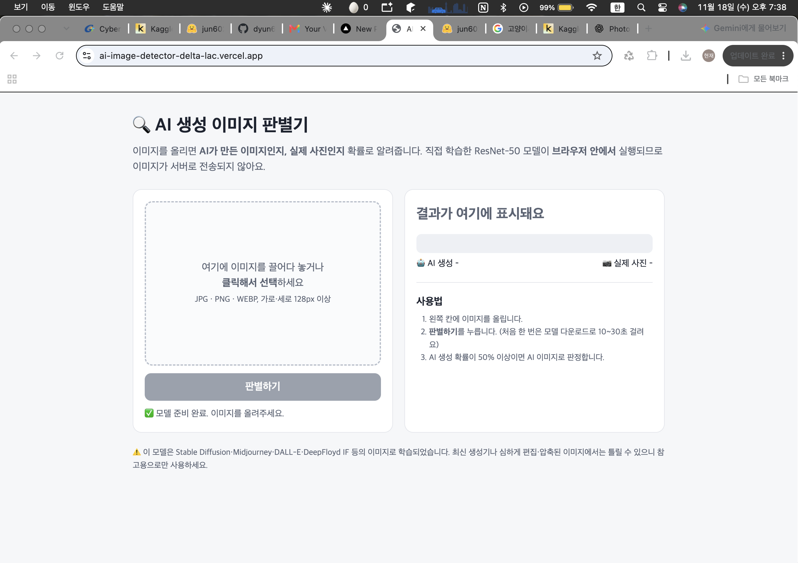 | 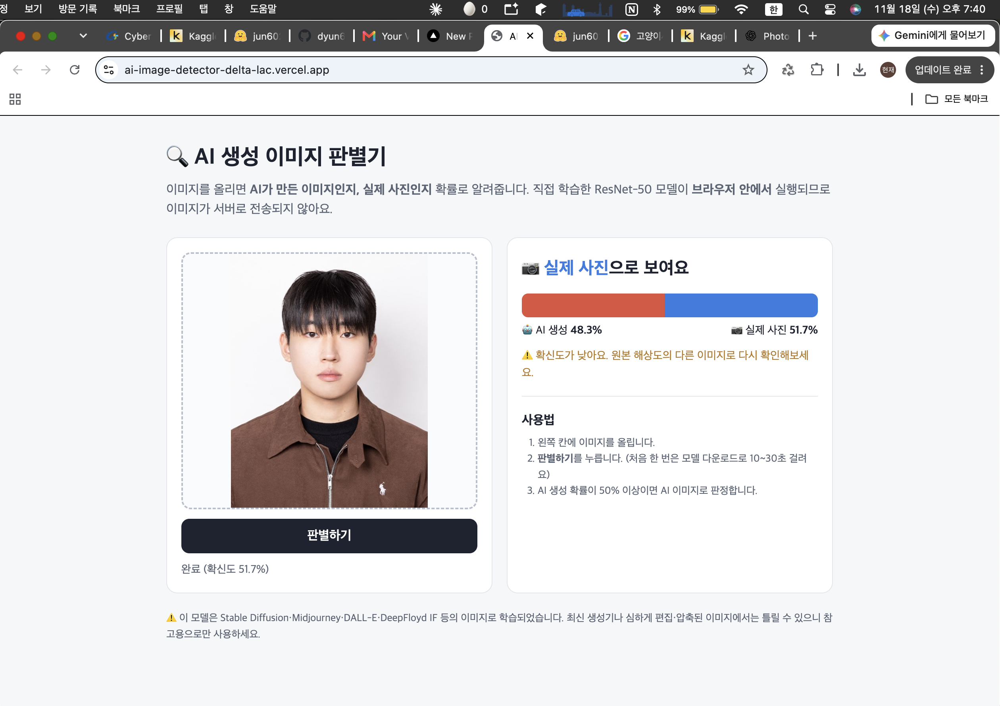 | 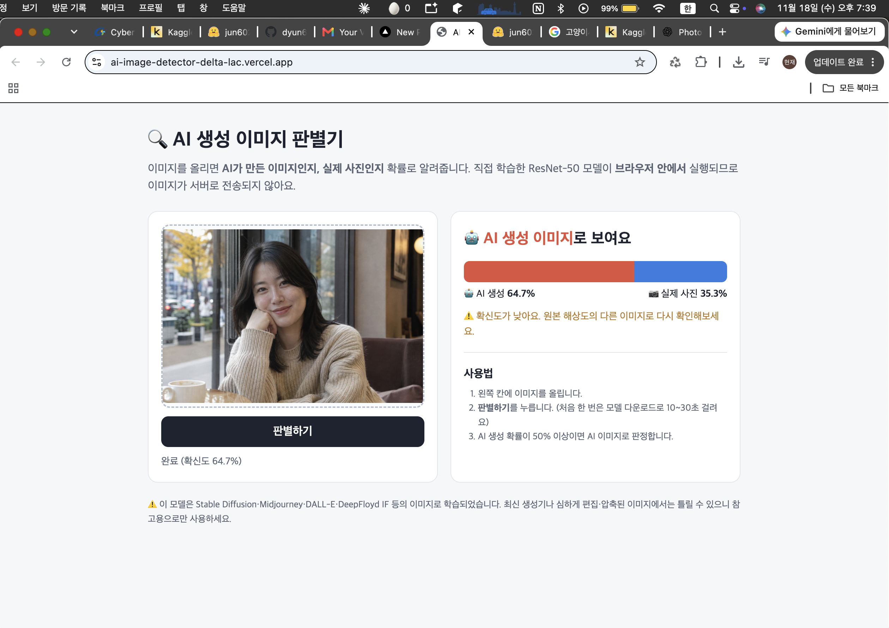 |

| 예외 처리: 작은 이미지 | 예외 처리: 이미지 아닌 파일 |
|---|---|
| 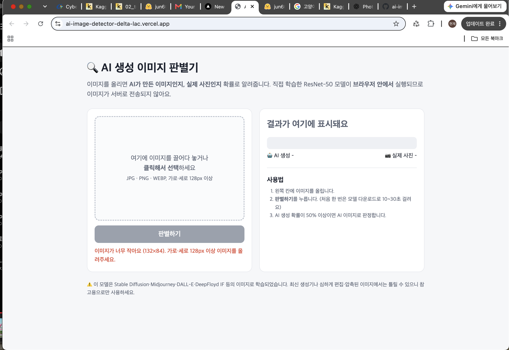 | 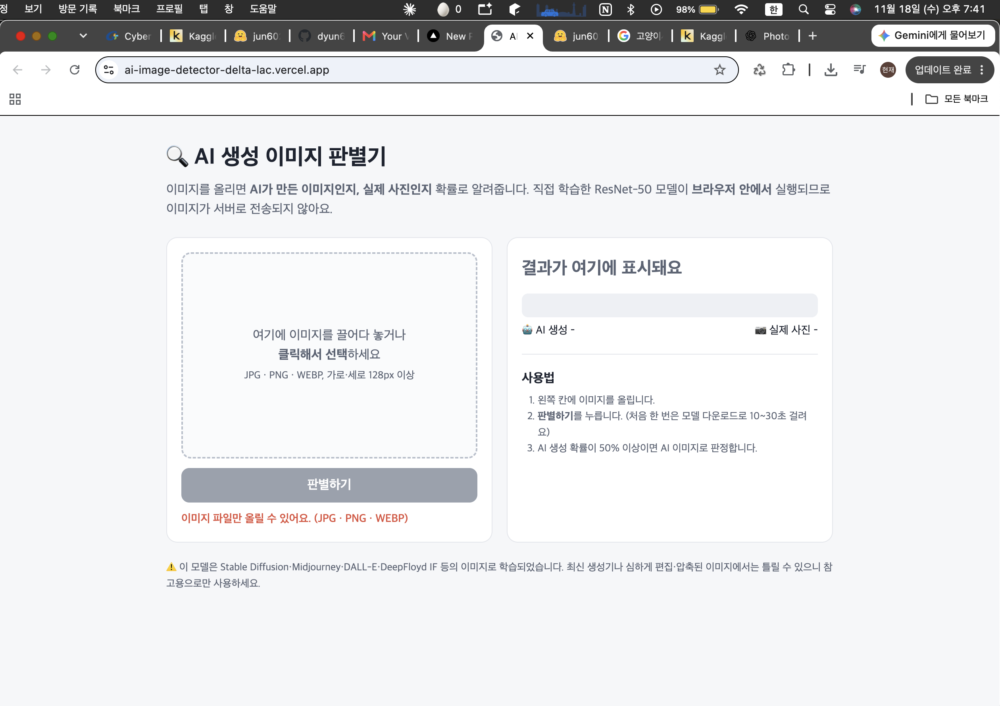 |

---

## 7. 배포

| 항목 | 내용 |
|---|---|
| 웹 페이지 | **Vercel** (정적 사이트, GitHub 저장소 연동 자동 배포) |
| 모델 파일 | **Hugging Face Hub** 모델 저장소 (90MB, 100MB 미만이지만 Git 용량 관리를 위해 분리) |
| 추론 엔진 | onnxruntime-web 1.20.1 (WebAssembly, 브라우저 내 실행) |
| 공개 URL | https://ai-image-detector-delta-lac.vercel.app/ |
| 모델 URL | https://huggingface.co/jun60287/ai-image-detector |

---

## 8. 실행 방법

### 실행 환경
- 학습: **Kaggle Notebook**, GPU **Tesla T4 ×2**, Python 3.13, PyTorch · torchvision · transformers · diffusers · scikit-learn · onnxruntime
- 서비스: 최신 브라우저 (Chrome · Safari · Edge), 별도 설치 불필요

### 저장소 구조
```
├── README.md
├── index.html                    # 배포한 웹 서비스 (Vercel)
├── requirements.txt              # 노트북 실행 패키지
├── submission.json
├── notebooks/
│   ├── 01_collect_data.ipynb     # 데이터 수집 · 정제 (출력 셀 포함)
│   ├── 02_train_eval.ipynb       # 분할 · ResNet-50 vs CLIP 학습 · 평가
│   └── 03_faces_retrain.ipynb    # 인물 데이터 보강 · ResNet-50 v2 재학습 · ONNX 변환
├── results/                      # 표 · 그래프 · 학습 로그
└── screenshots/
```

### 재현 순서
1. `01_collect_data.ipynb` (Kaggle, GPU T4, Internet On, 입력: `tristanzhang32/ai-generated-images-vs-real-images`) → 출력 `data.zip` 을 데이터셋으로 저장
2. `02_train_eval.ipynb` (입력: 1번 데이터셋) → ResNet-50 v1, CLIP 헤드 학습·평가
3. `03_faces_retrain.ipynb` (입력: 1번 데이터셋, `xhlulu/140k-real-and-fake-faces`, 2번 노트북 출력) → ResNet-50 v2 학습·평가, `resnet50.onnx` 생성
4. `resnet50.onnx` 를 HF Hub에 업로드 → `index.html` 의 `MODEL_URLS` 주소 확인 → Vercel 배포
5. 로컬 실행: `index.html` 과 같은 폴더에서 `python -m http.server 8000` → 브라우저에서 `http://localhost:8000`

### 가중치 위치
| 파일 | 크기 | 위치 |
|---|---|---|
| `resnet50.onnx` (**배포 모델, v2**) | 90MB | https://huggingface.co/jun60287/ai-image-detector |
| `resnet50_v2.pt` / `resnet50_best.pt` (v1) / `clip_head_best.pt` | 90MB / 90MB / 1.6MB | Kaggle 노트북 Output (`03`, `02` 노트북) |
| CLIP ViT-L/14 인코더 | 약 1.7GB | 공개 가중치 `openai/clip-vit-large-patch14` (실행 시 자동 다운로드) |

---

## 9. Lessons Learned

### PMI
**Plus (잘한 점)**
1. **형식 지름길을 미리 차단:** real은 JPEG, fake는 PNG가 많다는 점을 수집 단계에서 확인하고 두 클래스를 같은 해상도·JPEG 품질로 통일했다. 모델이 파일 형식이 아니라 이미지 내용을 보고 판단하도록 만든 핵심 설계였다.
2. **"처음 보는 생성기" 테스트셋을 따로 만든 것:** test 점수(F1 0.95)만 봤다면 "잘 된다"로 끝났겠지만, 별도 세트 덕분에 새 생성기에서 Recall이 떨어지는 실제 한계를 발견하고 개선 효과까지 측정할 수 있었다.
3. **배포 후 실사용 → 문제 발견 → 재학습 → 재배포 사이클을 직접 돌린 것:** 증명사진 오판을 발견한 뒤 얼굴 테스트셋으로 원인을 숫자로 확인(실제 얼굴 정답률 4.0%)하고, 데이터 보강으로 97.2%까지 끌어올려 같은 날 재배포했다.

**Minus (아쉬운 점)**
1. **real 데이터의 편향을 늦게 발견:** 실제 사진 쪽이 풍경·사물·그림 위주라는 점을 수집 단계에서 클래스 × 주제별로 점검했다면, 배포 전에 인물 편향을 막을 수 있었다.
2. **LAION 실제 이미지의 품질:** ELSA의 짝 실제 이미지 중 글자가 들어간 광고나 여러 사진을 붙인 콜라주가 섞여 있었고, URL의 절반가량이 만료돼 866장밖에 모으지 못했다.
3. **임계값 보정을 못 한 것:** CLIP이 처음 보는 생성기에서 AUC는 높은데 고정 임계값 0.5 때문에 F1이 낮았다. 별도의 "새 생성기 검증 세트"를 만들었다면 보정할 수 있었다.

**Interesting (흥미로운 점)**
1. **AUC와 F1이 반대 방향:** 같은 모델이 AUC로는 이기고 F1로는 지는 현상을 보며, "구분 능력"과 "판정 기준"은 별개의 문제라는 것을 체감했다.
2. **테스트 점수가 높아도 현실에서는 바로 틀린다:** test F1 0.92인 모델이 내 증명사진을 AI라고 했다. 테스트셋이 현실의 모든 유형을 대표하지 못한다는 것, 그리고 데이터가 모델의 "상식"을 정한다는 것을 직접 확인했다.
3. **데이터 보강의 파급 효과:** 얼굴 데이터만 추가했는데 얼굴과 무관한 처음 보는 생성기 F1까지 0.768 → 0.843으로 올랐다. 모델 구조를 바꾸는 것보다 데이터 다양성을 늘리는 것이 더 큰 효과를 낼 수 있었다.

### 문제 해결 사례
| | 사례 1: 증명사진 오판 (데이터 편향) | 사례 2: 이미지 생성 중 GPU 메모리 부족 | 사례 3: 무료 배포 플랫폼 문제 |
|---|---|---|---|
| **문제** | 배포한 서비스에 본인 증명사진을 올리자 AI 생성 이미지로 판정 | SDXL-Turbo로 8장씩 생성하다 `CUDA out of memory`, 재시도 시 `Input type (Half) and bias type (float)` 에러 | Hugging Face Spaces의 Gradio 서버 배포가 유료로 바뀌어 CLIP 앱(약 2GB)을 무료로 올릴 수 없었음 |
| **원인** | real 학습 데이터에 인물 사진이 부족해 "매끈한 얼굴 = AI" 지름길 학습 (얼굴 테스트에서 실제 얼굴 정답률 4.0%로 확인) | SDXL VAE가 fp16에서 불안정해 디코딩 시 fp32로 올라가며 메모리 급증, OOM으로 중단되면서 VAE가 fp32로 남아 자료형 불일치 | 서버형 배포는 무료 용량·플랜 제한, Vercel 서버리스 함수도 크기 제한(약 250MB) |
| **시도** | 실제 얼굴(FFHQ)과 AI 얼굴(StyleGAN)을 **함께** 추가(반대 편향 방지)하고, 얼굴 전용 테스트셋으로 v1·v2 비교 | ① 배치 8→4 + VAE 슬라이싱 ② fp16 전용 VAE(`madebyollin/sdxl-vae-fp16-fix`)로 교체 | 서버 대신 **브라우저에서 추론**하도록 구조 변경: ResNet-50을 ONNX로 변환 → 모델은 HF Hub, 웹페이지는 Vercel |
| **결과** | 실제 얼굴 정답률 4.0% → **97.2%**, 처음 보는 생성기 F1 0.768 → **0.843** | 1,500장 생성 성공, 메모리 사용량도 감소 | 무료·서버리스 배포 성공, 이미지가 서버로 전송되지 않는 개인정보 보호 장점까지 확보 |

### 향후 개선 계획
| 측면 | 계획 |
|---|---|
| **데이터** | ① 증명사진·셀카·보정 인물 사진 등 실사용 인물 유형 추가 ② FLUX, Midjourney v6, Nano Banana 등 최신 생성기 이미지 추가 ③ LAION 이미지에서 텍스트·콜라주를 자동 필터링 ④ 수집 단계에서 클래스 × 주제별 분포 점검 |
| **모델** | ① 새 생성기 검증 세트로 **임계값 보정**(temperature scaling) ② v2 데이터로 CLIP 헤드 재학습 및 ResNet + CLIP 앙상블 ③ 모델 양자화(int8)로 90MB → 약 25MB 경량화 |
| **서비스** | ① 판단 근거를 보여주는 Grad-CAM 히트맵 ② 여러 장 일괄 판별 ③ 사용자가 오판을 신고하면 재학습 데이터로 모으는 피드백 기능 |

---

*본 프로젝트의 데이터는 비상업적 교육 목적으로만 사용되었습니다.*
